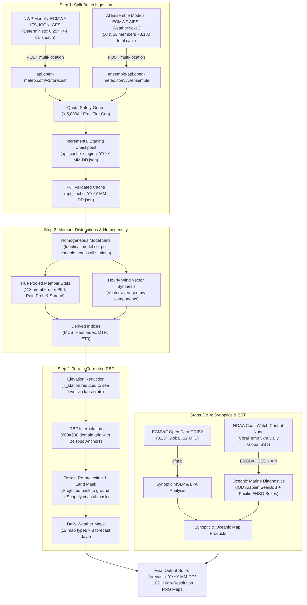

# MUGIL v19.5 — Complete Pipeline Technical Reference

> A multi-model ensemble weather forecasting system for South India, producing
> interpolated meteorological maps from 5 global NWP/AI models plus ECMWF
> high-resolution GRIB data and NOAA satellite SST diagnostics.

---

## Table of Contents
1. [Architecture Overview](#1-architecture-overview)
2. [Station Network & Configuration](#2-station-network--configuration)
3. [Data Acquisition & Quota Management (v19.5 Split Batch Ingestion)](#3-data-acquisition--quota-management-v195-split-batch-ingestion)
4. [Ensemble Weighting & True Member Statistics](#4-ensemble-weighting--true-member-statistics)
5. [Derived Variables & Indices](#5-derived-variables--indices)
6. [Spatial Interpolation & Homogeneous Model Sets](#6-spatial-interpolation--homogeneous-model-sets)
7. [ECMWF GRIB Automation](#7-ecmwf-grib-automation)
8. [Oceanic Diagnostics (IOD & Pacific SST via NOAA CoastWatch)](#8-oceanic-diagnostics-iod--pacific-sst-via-noaa-coastwatch)
9. [Map Rendering & Output Products](#9-map-rendering--output-products)
10. [Convergence Calculation & Recalibration](#10-convergence-calculation--recalibration)
11. [Known Approximations](#11-known-approximations)
12. [Changelog & Version History](#12-changelog--version-history)

---

## 1. Architecture Overview



### Pipeline Stages (in execution order)

| Stage | Description | Runtime |
|---|---|---|
| **Step 1** | Batched multi-location fetch (split forecast/ensemble endpoints) + elevation & incremental staging | ~1–2 min |
| **Step 2** | True member ensemble statistics, homogeneous blending, RBF terrain interpolation & map rendering (8 days × 12 map types) | ~6–8 min |
| **Step 3** | Download ECMWF Open Data GRIB2, extract T2m / MSLP / U10 / V10, synoptic LPA detection & isobaric rendering | ~1–2 min |
| **Step 4** | Fetch NOAA CoastWatch CoralTemp SST, render IOD (Arabian Sea & Bay of Bengal) and Pacific Basin ENSO tracking maps | ~30–45 s |

---

## 2. Station Network & Configuration

### 2.1 User-Configurable Station Network

While the default pipeline ships pre-configured for **South India** (78 observation points across 5 states/UTs), **all locations and sensors are fully user-configurable**:

- **User Configurable Dictionary**: The observation points are defined in the `locations` dictionary in [`mugil_v19.5.py`](mugil_v19.5.py):
  ```python
  locations = {
      "Chennai": (13.0827, 80.2707),
      "Bengaluru": (12.9716, 77.5946),
      "Kochi": (9.9312, 76.2673),
      # Add, remove, or substitute any arbitrary cities or sensor coordinates worldwide
  }
  ```
- **Portable Boundary & Mask Adaptation**: If monitoring other geographical regions (e.g., North India, Europe, Southeast Asia), adjust the Natural Earth `target_states` list and domain bounds (`minx`, `maxx`, `miny`, `maxy`). The RBF interpolation, elevation reduction, and Cartopy rendering automatically conform to any configured latitude/longitude bounds.
- **Topographic Anchors**: Topographic anchor points (`topo_anchors = [(lat, lon, elevation_m), ...]`) provide boundary-condition constraints (peaks and coastlines) for RBF elevation modeling, and can be customized to match any target topography.

### 2.2 Default South Indian Reference Network

The included reference network monitors **78 observation stations** across 5 southern states/UTs:

- **Tamil Nadu** — 49 stations (Chennai, Madurai, Coimbatore, Salem, Trichy, Tirunelveli, Erode, Vellore, Kodaikanal, Ooty, Valparai, etc.)
- **Kerala** — 13 stations (Thiruvananthapuram, Kochi, Munnar, Idukki, Wayanad, Kozhikode, Thrissur, Palakkad, Alappuzha, Kollam, Kasaragod, Kannur, Malappuram)
- **Karnataka** — 10 stations (Bengaluru, Mysuru, Mangaluru, Agumbe, Madikeri, Chikmagalur, Shivamogga, Hassan, Udupi, Tumkur)
- **Andhra Pradesh** — 5 stations (Tirupati, Nellore, Kadapa, Anantapur, Horsley Hills)
- **Puducherry** — 1 station (Pondicherry)

### 2.3 Topographic Anchors

In addition to the 78 city stations, **24 topographic anchor points** constrain elevation interpolation:

- **6 mountain peaks** with known elevations (Anamudi/Munnar crest 2695m, Doddabetta/Ooty 2637m, Mullayanagiri/Chikmagalur 1930m, Agasthyamalai 1868m, Horsley Hills 1110m, Tirumala 970m)
- **18 coastal zero-elevation anchors** along the Arabian Sea and Bay of Bengal coastlines

---

## 3. Data Acquisition & Quota Management (v19.5 Split Batch Ingestion)

### 3.1 The Open-Meteo Quota Bottleneck & The v19.5 Split Architecture

Open-Meteo calculates request consumption on a **weighted call volume formula**:
$$\text{Weight} = n_{\text{locations}} \times \left(\frac{n_{\text{days}}}{14}\right) \times \left(\frac{n_{\text{vars}}}{10}\right) \times n_{\text{members}}$$

Under Open-Meteo's non-commercial free tier, accounts are strictly limited to:
* **Minutely Limit:** 600 calls/min
* **Hourly Limit:** 5,000 calls/hr
* **Daily Limit:** 10,000 calls/day

#### Why Previous Architectures Failed:
1. **v19.4 Request Storm:** Sent 78 stations × 5 models = 390 separate asynchronous GET requests. This burst tripped the minutely burst limiter and silently dropped AIFS and WeatherNext at 58 of 78 stations due to inadequate retry backoffs.
2. **Naive Multi-Location Querying:** Sending all 5 models to `ensemble-api.open-meteo.com` across 78 locations with 10 variables and 50 members generates $\approx 2,785$ weighted calls per request. After just 2 models (ECMWF IFS + ECMWF AIFS), $\approx 5,570$ calls are consumed, completely locking the IP out of the hourly quota and causing WeatherNext 2, ICON, and GFS to fail with HTTP 429 (`Hourly API request limit exceeded`).

#### The v19.5 Solution: Split Routing by Model Class

MUGIL v19.5 divides the 5 models between the standard deterministic forecast endpoint and the ensemble endpoint based on model architecture:

| Model | Target API Endpoint | Call Weight | Members | Supported Variables |
|---|---|---|---|---|
| **ECMWF IFS 0.25°** | `https://api.open-meteo.com/v1/forecast` | $\approx$ 44 | Deterministic | All 10 daily vars + hourly wind |
| **DWD ICON Global** | `https://api.open-meteo.com/v1/forecast` | $\approx$ 44 | Deterministic | All 10 daily vars + hourly wind |
| **NCEP GFS Seamless** | `https://api.open-meteo.com/v1/forecast` | $\approx$ 44 | Deterministic | All 10 daily vars + hourly wind |
| **ECMWF AIFS 0.25°** | `https://ensemble-api.open-meteo.com/v1/ensemble` | $\approx$ 1,780 | 50 members | 8 native daily vars (omits dummy CAPE/gusts) |
| **Google WeatherNext 2** | `https://ensemble-api.open-meteo.com/v1/ensemble` | $\approx$ 1,400 | 63 members | 5 native daily vars (omits dummy CAPE/gusts/dewpoint/VPD/ET0) |

- **Total Calls on `ensemble-api`:** $1,780 + 1,400 = \mathbf{3,180}$ calls ($\ll 5,000/\text{hr}$ cap).
- **Total Calls on `forecast`:** $44 \times 3 = \mathbf{132}$ calls ($\ll 5,000/\text{hr}$ cap).
- **Total Run Consumption:** $\approx \mathbf{3,312}$ calls. Fits comfortably within the hourly budget on any connection or hotspot without a single 429 error.

### 3.2 Smart 429 Handling & Pacing

The network layer in [`mugil_v19.5.py`](mugil_v19.5.py) integrates adaptive backoff logic:
- **Fair-use inter-call pacing:** `_pace(min_gap=5.0)` enforces a mandatory 5-second sleep between heavy multi-location payloads to prevent tripping the 600/min burst regulator.
- **Differentiated 429 handling:**
  - If response contains `"Minutely API request limit exceeded"`: sleeps a full 60 seconds (matching Open-Meteo's exact sliding window) rather than futile 20s retries.
  - If response contains `"Hourly API request limit exceeded"`: aborts immediately rather than stalling the user in 5-minute exponential backoff loops when the hour is locked.

### 3.3 Incremental Staging Checkpoint Cache

To safeguard against interrupted runs or network drops, v19.5 introduces **checkpointed staging**:
- Each model response is committed immediately upon parsing into `api_cache_staging_YYYY-MM-DD.json`.
- If the script is aborted or interrupted on model 4, re-running the script automatically restores models 1, 2, and 3 from disk in `<0.1` seconds, querying only the remaining models.
- When all 5 models are verified and complete, the final schema-v2 cache (`api_cache_YYYY-MM-DD.json`) is written and the staging file is purged.
- **Degraded-run protection:** Incomplete runs (where an ensemble model produced 0 members) are never written to the permanent cache, ensuring degraded runs cannot corrupt future forecasts.

---

## 4. Ensemble Weighting & True Member Statistics

### 4.1 Models and Base Weights

| Model | Key | Base Weight | Target Endpoint | Type |
|---|---|---|---|---|
| ECMWF IFS 0.25° | `ecmwf_ifs025` | **35%** | Forecast | Physics NWP (High-res 0.25°) |
| ECMWF AIFS 0.25° | `ecmwf_aifs025` | **25%** | Ensemble | AI/ML (ECMWF Graph Neural Network, 50 mem) |
| Google WeatherNext 2 | `google_weathernext2_ensemble` | **20%** | Ensemble | AI/ML (Google DeepMind DL Ensemble, 63 mem) |
| DWD ICON Global | `icon_global` | **10%** | Forecast | Physics NWP |
| NCEP GFS Seamless | `gfs_seamless` | **10%** | Forecast | Physics NWP |

### 4.2 Variable-Specific Weights

| Variable | Top Models & Weights | Physical Rationale |
|---|---|---|
| **Precipitation** | ECMWF IFS (45%), ICON (25%), AIFS (15%), WeatherNext 2 (10%), GFS (5%) | Explicit cloud microphysics models outperform AI models in precipitation localization |
| **Temperature** | ECMWF AIFS (35%), WeatherNext 2 (30%), ECMWF IFS (20%), ICON (10%), GFS (5%) | AI models excel at thermal dynamics and smooth temperature gradients |
| **Wind Gusts** | ECMWF IFS (40%), ICON (30%), AIFS (15%), WeatherNext 2 (10%), GFS (5%) | Convective gust parameterization requires high-resolution physical modeling |

### 4.3 True Pooled Ensemble Member Statistics (v19.5 Upgrade)

In v19.4, "P90" was calculated as the 2nd-highest of 5 deterministic models, and "probability" was a crude 5-sample vote. 

**v19.5 computes true multi-model ensemble member statistics:**
- **Pooled Ensemble Pool:** Combines the individual perturbed ensemble runs from ECMWF AIFS (50 members) and Google DeepMind WeatherNext 2 (63 members), yielding a **113-member ensemble distribution** for precipitation.
- **Weighted Member Percentiles (P90):**
  Each member inherits its parent model's normalized weight: $w_{i, \text{member}} = \frac{w_{\text{model}}}{N_{\text{members}}}$.
  P90 is evaluated by cumulative sorting over the weighted member distribution:
  $$\text{CDF}(x) = \sum_{j: x_j \le x} w_j \quad \Longrightarrow \quad P_{90} = \text{CDF}^{-1}(0.90)$$
- **Ensemble Probability of Rain:**
  Calculated across all 113 members against the standard $1.0\text{ mm/day}$ threshold:
  $$\text{Prob}(\text{Rain} \ge 1.0\text{ mm}) = 100 \times \frac{\sum w_j \cdot \mathbb{I}(x_j \ge 1.0\text{ mm})}{\sum w_j}$$
- **Ensemble Spread:** Evaluated as the member-distribution spread ($P_{90} - P_{10}$) rather than inter-model divergence.

---

## 5. Derived Variables & Indices

### 5.1 MCS (Mesoscale Convective System) Score — 0 to 10
Estimates severe thunderstorm and organized convective squall potential:
```
Score = comp_precip + comp_gusts + comp_cape    (clamped to [0, 10])

comp_precip = min(4.0, P90 / 12.5)             if P90 > 1 mm, else 0
comp_gusts  = min(3.0, max(0, (gusts − 30) / 13.3))
comp_cape   = min(3.0, max(0, (CAPE − 200) / 766))
```

### 5.2 Heat Score — 0 to 10
Evaluates tropical humid heatwave severity combining dry bulb, vapor pressure deficit, and dewpoint:
```
Score = comp_temp + comp_vpd + comp_dewpoint    (clamped to [0, 10])

comp_temp     = min(4.0, max(0, (Tmax − 35) / 1.5))
comp_vpd      = min(3.0, max(0, (VPD − 1.5) / 0.83))
comp_dewpoint = min(3.0, max(0, (Dp − 24) / 2.0))
```

### 5.3 NWS Rothfusz Heat Index
Apparent temperature computed from $T_{\max}$ and dewpoint using the full NOAA/NWS Rothfusz regression with low and high relative humidity adjustments.

### 5.4 Hourly Wind Vector Daily Means
Replaced the v19.4 `windspeed_max × 0.50` heuristic. The pipeline queries hourly $u$ and $v$ wind components from ECMWF IFS, ICON, and GFS on `api.open-meteo.com/v1/forecast`, vector-averaging each component over the 24-hour cycle:
$$\bar{u} = \frac{1}{24}\sum_{h=1}^{24} -s_h \sin(\theta_h), \quad \bar{v} = \frac{1}{24}\sum_{h=1}^{24} -s_h \cos(\theta_h)$$
This prevents opposing morning and evening sea-breeze vectors from producing artificial high-speed cancellations.

---

## 6. Spatial Interpolation & Homogeneous Model Sets

### 6.1 Homogeneous Model Sets per Variable (v19.5 Upgrade)
In v19.4, weights were renormalized per-station. If station A had 5 models and station B had 3 models, they entered the Radial Basis Function (RBF) interpolator with different estimators, producing artificial spatial discontinuities in the meteorological fields.

**v19.5 enforces strict domain homogeneity:**
- Every variable on every forecast day is blended over **ONE fixed model set across all stations**.
- If a station lacks a model that is present at $\ge 95\%$ of other stations, that individual station is dropped from the RBF for that specific variable rather than compromising the estimator across the entire domain.
- **Per-variable model sets:** Variables are only blended over models that natively generate them (e.g., wind gusts and CAPE are evaluated over IFS + ICON + GFS; AIFS and WeatherNext 2 are excluded from gust/CAPE fields rather than injecting NaNs).

### 6.2 Elevation Reduction & Terrain Correction
1. Station temperatures are reduced to sea level using a tropical environmental lapse rate ($6.5^\circ\text{C/km}$ for day maximums, $3.0^\circ\text{C/km}$ for nighttime minimums):
   $$T_{\text{sea\_level}} = T_{\text{station}} + \Gamma \times Z_{\text{station}}$$
2. Thin Plate Spline (TPS) RBF interpolation generates the continuous sea-level temperature field on a $600 \times 600$ grid.
3. Temperatures are re-projected back to the terrain elevation surface:
   $$T_{\text{ground}} = T_{\text{sea\_level}} - \Gamma \times Z_{\text{grid}}$$

---

## 7. ECMWF GRIB Automation

In Step 3, MUGIL connects to **ECMWF Open Data** via `ecmwf.opendata.Client` (resolving global 0.25° GRIB2 forecasts at 12:00 UTC):
- **Synoptic Mean Sea Level Pressure (MSLP):** Contoured at 2 hPa intervals.
- **Low Pressure Area (LPA) Detection:** Scans local MSLP minima using a 150-pixel footprint (~180 km) with closed-circulation verification.
- **Surface Wind Convergence:** True instantaneous divergence $-\nabla \cdot \vec{V}$ computed on the native 0.25° ECMWF grid.

---

## 8. Oceanic Diagnostics (IOD & Pacific SST via NOAA CoastWatch)

### 8.1 NOAA CoastWatch Central Node Migration (v19.5 Upgrade)

In v19.5, [`mugil_sst_maps.py`](mugil_sst_maps.py) has been upgraded to resolve connection timeouts encountered on the legacy West Coast node (`coastwatch.pfeg.noaa.gov`):
- **Primary Server:** Migrated to NOAA CoastWatch Central Node (`https://coastwatch.noaa.gov/erddap/griddap/`).
- **Dataset:** NOAA Coral Reef Watch Daily Global 5km Satellite SST (`noaacrwsstDaily` / CoralTemp v3.1), providing daily near-real-time global SST with 1–2 day operational latency.
- **Dynamic Schema Inspection:** Unpacks coordinate and variable dimensions dynamically by name (`time`, `latitude`, `longitude`, `analysed_sst`), ensuring compatibility across ERDDAP revisions.
- **International Dateline Longitude Stitching:** Because global grids use $-180^\circ$ to $+180^\circ$ coordinates, the Pacific query is fetched in two continuous slices ($120^\circ\text{E}$ to $180^\circ\text{E}$ and $-180^\circ\text{W}$ to $-80^\circ\text{W}$), with the eastern slice shifted by $+360^\circ$ to assemble a seamless $120^\circ\text{E}$ to $280^\circ\text{E}$ trans-Pacific raster.

### 8.2 Marine Diagnostic Maps

1. **Indian Ocean Dipole (IOD) Map (`00_iod_arabian_sea_bob_sst.png`):**
   - High-resolution thermal mapping across Arabian Sea and Bay of Bengal ($0^\circ–25^\circ\text{N},\; 55^\circ–98^\circ\text{E}$).
   - Solid land mass masking ensures only ocean surface temperatures are rendered.
2. **Pacific Ocean Basin ENSO Tracking Map (`00_pacific_enso_sst.png`):**
   - Trans-Pacific view ($-60^\circ\text{S}$ to $+65^\circ\text{N},\; 120^\circ\text{E}$ to $280^\circ\text{E}$).
   - Renders the 4 official WMO/NOAA ENSO monitoring boxes: **Niño 4**, **Niño 3.4**, **Niño 3**, and **Niño 1+2**.
   - Computes live spatial mean SST inside the **Niño 3.4 box** ($5^\circ\text{N}–5^\circ\text{S},\; 170^\circ\text{W}–120^\circ\text{W}$) with real-time El Niño / La Niña threshold stamping.

---

## 9. Map Rendering & Output Products

### 9.1 Output Map Catalog

For **each of the 8 forecast days** (Day 1 to Day 8), 12 daily maps are generated:

| # | Filename Pattern | Product Name | Colormap | Scale Range |
|---|---|---|---|---|
| 01 | `01_maxtemp_T{n}_{date}.png` | Peak Temperature | `magma_r` | 24–44 °C |
| 02 | `02_precip_T{n}_{date}.png` | Precipitation (Ensemble P90) | `viridis` | LogNorm, $\ge 1.0\text{ mm}$ |
| 02b | `02b_precip_prob_T{n}_{date}.png` | Probability of Rain ($\ge 1\text{ mm}$) | `Blues` | 0–100 % |
| 02c | `02c_precip_spread_T{n}_{date}.png` | Ensemble Precip Spread ($P_{90}-P_{10}$) | `YlGnBu` | 0–50 mm |
| 03 | `03_mcs_T{n}_{date}.png` | MCS / Squall Risk Index | Custom 6-tier | 0–10 (categorical) |
| 04 | `04_gusts_T{n}_{date}.png` | Maximum Wind Gusts | `plasma_r` | 0–80 km/h |
| 05a | `05a_heat_index_T{n}_{date}.png` | NWS Heat Index (Apparent Temp) | `OrRd` | 30–50 °C |
| 05b | `05b_heatwave_T{n}_{date}.png` | Heatwave Severity Index | Custom 5-tier | 0–10 (categorical) |
| 06 | `06_dtr_T{n}_{date}.png` | Diurnal Temperature Range | `turbo` | 2–18 °C |
| 07 | `07_mintemp_T{n}_{date}.png` | Nighttime Minimum Temperature | `inferno` | 18–32 °C |
| 08 | `08_et0_T{n}_{date}.png` | FAO Reference Evapotranspiration | `YlOrBr` | 2–8 mm/day |
| 09 | `09_convergence_T{n}_{date}.png` | Near-Surface Wind Convergence | `PiYG` | Auto-scaled to p95 |

**Plus standalone synoptic and oceanic products:**

| Filename | Product | Source |
|---|---|---|
| `00_google_terrain_basemap.png` | Reference Topographic Basemap | Clean Google Terrain |
| `00_ecmwf_raw_t2m.png` | ECMWF Synoptic 2m Temperature | ECMWF Open Data GRIB2 |
| `00_ecmwf_mslp_lpa.png` | MSLP Isobars & LPA Tracking | ECMWF Open Data GRIB2 |
| `00_ecmwf_convergence_snapshot.png` | Native Grid Convergence Snapshot | ECMWF Open Data GRIB2 |
| `00_iod_arabian_sea_bob_sst.png` | Indian Ocean Dipole (Arabian Sea & Bay of Bengal SST) | NOAA CoastWatch CoralTemp 5km |
| `00_pacific_enso_sst.png` | Pacific Basin ENSO Tracking (Niño 1+2, 3, 3.4, 4) | NOAA CoastWatch CoralTemp 5km |

**Total Output:** **$\approx$ 102+ maps per pipeline run** (8 days × 12 daily products + 6 synoptic/marine products).

---

## 10. Convergence Calculation & Recalibration

Horizontal wind convergence is evaluated as the negative 2D velocity divergence:
$$\text{Convergence} = -\left(\frac{\partial u}{\partial x} + \frac{\partial v}{\partial y}\right)$$
- **v19.5 Recalibration:** Daily convergence maps are auto-scaled to the day's 95th percentile ($p_{95}$) rather than a fixed arbitrary scale that caused blank maps during weak synoptic flow.
- **Offshore TPS Tapering:** Offshore extrapolation is smoothly tapered toward zero beyond station confidence buffers to prevent unbounded divergence artifacts over the open sea.

---

## 11. Known Approximations

1. **AI Model Boundary Fields:** ECMWF AIFS and Google WeatherNext 2 predict primary tropospheric and surface prognostic variables. Diagnostic fields (such as convective CAPE and surface gusts) are not natively parameterized in AI models and are properly delegated to physics-based NWP models (IFS, ICON, GFS).
2. **Current Day Observations (Day 1 / Day 0):** The day 1 forecast blends early-morning analysis observations with short-range forecast model runs.
3. **Precipitation Non-Negativity:** RBF Thin Plate Spline surfaces do not mathematically enforce zero-flooring. Values $< 1.0\text{ mm}$ are masked to NaN prior to rendering to eliminate interpolation undershoot.

---

## 12. Changelog & Version History

### v19.5 (Current Revision)
- **Split Ingestion Architecture (Quota & Rate Limit Fix):** Completely resolved Open-Meteo HTTP 429 quota exhaustion. Physics NWP models (ECMWF IFS, ICON Global, GFS) are routed to `api.open-meteo.com/v1/forecast` ($\sim 44$ calls each) while AI models (ECMWF AIFS, Google WeatherNext 2) are routed to `ensemble-api.open-meteo.com/v1/ensemble` ($\sim 3,180$ total calls). Total consumption ($\approx 3,312$ calls) runs comfortably within the 5,000/hr free-tier cap.
- **Smart 429 Backoff & Pacing:** Enforced 5.0s fair-use inter-call pacing. Minutely 429 errors sleep a full 60 seconds; hourly quota errors abort immediately to prevent trapped 5-minute retry loops.
- **Incremental Staging Checkpoints (`api_cache_staging_YYYY-MM-DD.json`):** Each model's response is written to disk immediately upon completion. If a run is interrupted, previously fetched models are restored instantly without re-querying Open-Meteo.
- **True Multi-Model Ensemble Member Statistics:** Precipitation P90, probability-of-rain, and spread are calculated directly across 113 pooled ensemble members (50 from AIFS, 63 from WeatherNext 2) using weighted percentile integration.
- **Homogeneous Model Sets:** Every (day, variable) is blended over a single uniform model set across all stations before entering the RBF interpolator, eliminating spatial estimator discontinuities.
- **Per-Variable Model Sets:** Variables are queried only from models that natively support them (omits non-existent CAPE/gusts from AIFS and WeatherNext 2, slashing request weight by $\approx 40\%$).
- **Hourly Wind Vector Averaging:** True 24-hour vector averaging of $u$ and $v$ components from hourly wind data replaces the $\times 0.50$ maximum speed approximation.
- **NOAA CoastWatch Central Node Migration:** Upgraded [`mugil_sst_maps.py`](mugil_sst_maps.py) to NOAA's primary host `https://coastwatch.noaa.gov` (CoralTemp 5km global SST) with dynamic column mapping and $120^\circ–280^\circ\text{E}$ dateline stitching, eliminating connection timeouts on the West Coast node.
- **New Probability and Spread Products:** Added dedicated daily map products for Ensemble Probability of Rain (`02b`) and Ensemble Precipitation Spread (`02c`).

### v19.4.2
- **NOAA OISST Near-Real-Time (NRT) Routing**: Switched ERDDAP dataset targets to Near-Real-Time aggregations (`ncdcOisst21NrtAgg_LonPM180` and `ncdcOisst21NrtAgg`), eliminating the ~16-day latency on oceanic SST maps.

### v19.4
- **Google WeatherNext 2 Integration**: Integrated Google DeepMind's operational **WeatherNext 2** (`google_weathernext2_ensemble`, 20% ensemble weight).
- **ECMWF AIFS Endpoint Routing**: Routed `ecmwf_aifs025` to Open-Meteo's `ensemble-api.open-meteo.com/v1/ensemble` endpoint.
- **Oceanic SST Diagnostics Module**: Integrated high-resolution NOAA OISST v2.1 maps for the Indian Ocean Dipole and Pacific Basin ENSO tracking.

### v19.3
- **Sea-Level Temperature Reduction**: Station temperatures reduced to sea level before RBF interpolation and projected back using 3.0°C/km night lapse.
- **Physical Scale Convergence**: Scaled wind convergence using actual physical distance (meters) based on grid latitude, scaled to 10⁻⁵ s⁻¹.
- **Heat Index Revision**: Implemented standard NWS Rothfusz regression with high/low relative humidity adjustments.
