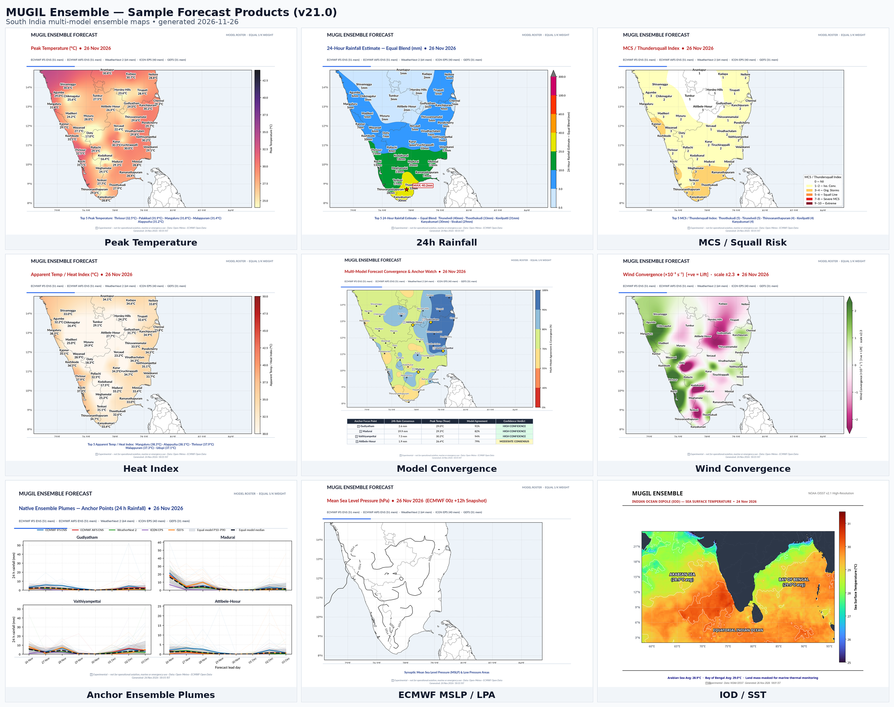

# MUGIL Ensemble ☁️🌦️

**Weather forecasts for South India, made by many models thinking together.**

MUGIL Ensemble is an open-source Python pipeline that turns multi-model weather data into beautiful, easy-to-read forecast maps, rain probabilities, heat/storm indicators, and regional scenario summaries. It’s built for curious humans, researchers, farmers, planners, weather nerds, and anyone who likes their forecasts with a little more context and a lot more color.

> ⚠️ **Friendly note:** MUGIL is an experimental research project. It’s great for learning, exploration, and planning conversations — but please don’t use it for operational aviation, marine, emergency, or life-safety decisions.



## Why MUGIL is fun

- **Many brains, one forecast:** blends global NWP + AI weather models instead of trusting just one.
- **Maps you can actually read:** clean vector basemaps, clear labels, and purpose-built weather products.
- **Probabilities, not just vibes:** rain/heat/gust exceedance probabilities and model-agreement views.
- **Built for South India, configurable for anywhere:** the default station network covers South India, but you can adapt it to your own region.
- **Open and hackable:** MIT licensed, plain Python, and ready for experiments.

## What you get

A typical run produces a daily forecast folder with maps and reports, including:

| What | Why it’s useful |
|---|---|
| 🌡️ Peak/min temperature, DTR, heat index | Spot hot days, warm nights, and comfort stress |
| 🌧️ Rainfall, rain probability, threshold probabilities | See not just “how much”, but “how likely” |
| ⛈️ MCS/squall risk, wind gusts, convergence | Get a sense of stormy or convective setups |
| 🧭 Model convergence / agreement | Know when models agree — and when they’re arguing |
| 📈 Anchor ensemble plumes | See member spread over time for key locations |
| 🧾 Regional scenario summary (`.md`) | A quick human-readable daily briefing |
| 🌊 IOD / Pacific SST diagnostics | Extra ocean context for the bigger picture |
| 🌀 ECMWF GRIB synoptic snapshots | MSLP/LPA and convergence context from ECMWF Open Data |

## Quick start

### 1) Clone and set up

```bash
git clone https://github.com/auarunkumar1/mugil-ensemble.git
cd mugil-ensemble

python -m venv .venv
source .venv/bin/activate   # Windows: .venv\Scripts\activate
pip install -r requirements.txt
```

### 2) Run the latest pipeline

```bash
python mugil_v21.py
```

### 3) Open your outputs

Look in the generated folder:

```text
forecasts_v21_YYYY-MM-DD/
```

You’ll find PNG maps, a regional scenario markdown report, and a run manifest JSON.

## The latest: v21.0 highlights

`mugil_v21.py` is the current surgical reliability update on top of v20:

- **Isolated v21 outputs/cache/manifests** — v20 artifacts aren’t overwritten.
- **Honest probabilities** — models without real member arrays are excluded from exceedance probabilities; no fabricated pseudo-members.
- **Cleaner GRIB handling** — cfgrib datasets are explicitly closed after use.
- **More readable anchor plumes** — independent y-axes per anchor location.
- **Run manifest** — machine-readable JSON with model coverage, warnings, cache status, and artifacts.
- **Small cleanup** — stale labels removed and minor import hygiene.

## How it works (the friendly version)

1. **Fetch** — pulls forecast/ensemble data from Open-Meteo (and ECMWF Open Data GRIB for synoptic snapshots).
2. **Blend** — combines models with equal model weight for probabilities, plus robust consensus diagnostics.
3. **Interpolate** — spreads station/model values across a grid with terrain-aware adjustments.
4. **Render** — draws maps, plume charts, scenario reports, and ocean diagnostics.
5. **Save** — writes a dated output folder you can browse, share, or archive.

## Configure it for your region

The default setup is tuned for South India, but MUGIL is meant to be adapted.

In the script, look for:

- `locations` — station/city coordinates
- `ANCHOR_POINTS` / `CORE_REGIONS` — focus locations and summary regions
- `topo_anchors` — terrain anchors (peaks/coasts) for interpolation support
- domain bounds / target states — map extent and mask

If you move it to another region, update the locations, bounds, and topographic anchors so the map and interpolation make sense there.

## Project files

| File | What it is |
|---|---|
| `mugil_v21.py` | Latest pipeline (recommended) |
| `mugil_v20.py` | Native multi-model ensemble v20 pipeline |
| `mugil_v19.6.py` ... `mugil_v19.3.py` | Earlier versions kept for history/reference |
| `mugil_sst_maps.py` | IOD/Pacific SST diagnostic map helper |
| `requirements.txt` | Python dependencies |
| `assets/sample_collage.png` | Sample output collage used in this README |

## Output naming

MUGIL writes dated outputs so runs don’t step on each other:

```text
forecasts_v21_YYYY-MM-DD/                  # maps, reports, manifest
api_cache_v21_YYYY-MM-DD.json              # full-day cache (if complete)
api_cache_v21_staging_YYYY-MM-DD.json      # checkpoint during fetch
run_manifest_v21_YYYY-MM-DD.json           # inside output folder
```

## Data sources & thanks

MUGIL stands on the shoulders of great open data/services:

- [Open-Meteo](https://open-meteo.com/) for forecast and ensemble APIs
- [ECMWF Open Data](https://www.ecmwf.int/en/forecasts/datasets/open-data) for GRIB synoptic products
- [NOAA CoastWatch / ERDDAP](https://coastwatch.noaa.gov/) for SST diagnostics
- Natural Earth / Cartopy / Matplotlib / SciPy / NumPy / Pandas and the Python open-source ecosystem

Please review upstream data terms and attribution requirements when using or redistributing derived products.

## Contributing

Ideas, bug reports, tweaks, and forecast nerdery are all welcome. If you improve a score, add a region, calibrate probabilities, or make the maps prettier — that’s awesome.

Good first contributions:

- add verification/calibration against observations
- improve terrain-aware downscaling
- add new regions/station packs
- export GeoTIFF/NetCDF/CSV artifacts
- build a small web viewer for the generated outputs

## License

MIT — see [LICENSE](LICENSE).

---

*Made with curiosity, coffee, ensemble spreads, and a healthy respect for uncertainty.*