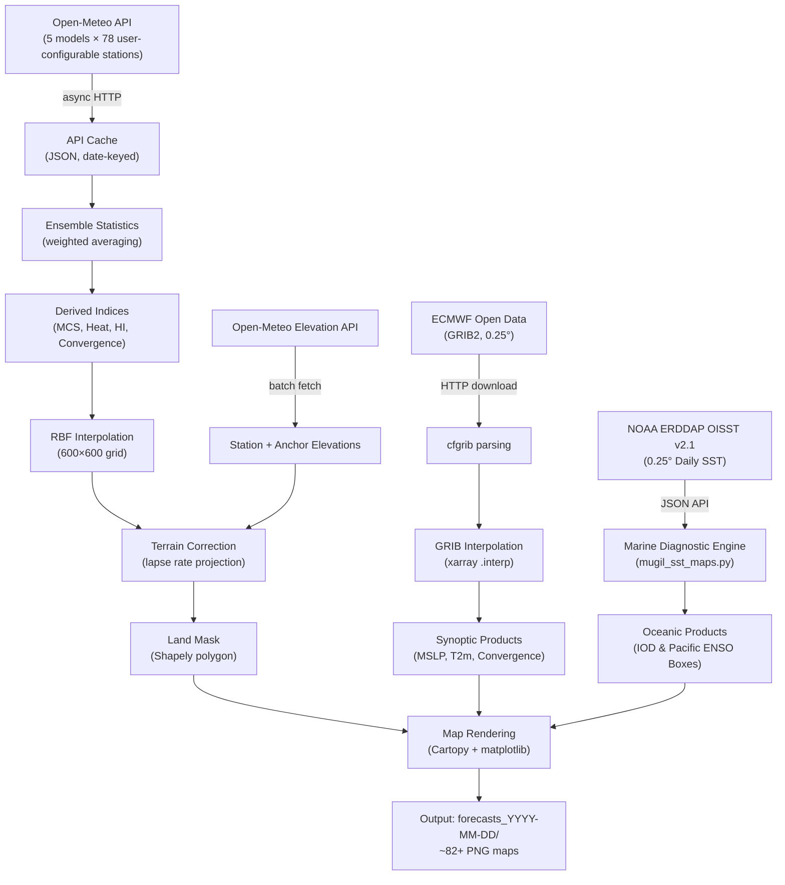

# MUGIL v19.4 — Complete Pipeline Technical Reference

> A multi-model ensemble weather forecasting system for South India, producing
> interpolated meteorological maps from 5 global NWP/AI models plus ECMWF
> high-resolution GRIB data.

---

## Table of Contents
1. [Architecture Overview](#1-architecture-overview)
2. [Station Network & Configuration](#2-station-network--configuration)
3. [Data Acquisition](#3-data-acquisition)
4. [Ensemble Weighting](#4-ensemble-weighting)
5. [Derived Variables & Indices](#5-derived-variables--indices)
6. [Spatial Interpolation & Terrain Correction](#6-spatial-interpolation--terrain-correction)
7. [ECMWF GRIB Automation](#7-ecmwf-grib-automation)
8. [Oceanic Diagnostics (IOD & Pacific SST)](#8-oceanic-diagnostics-iod--pacific-sst)
9. [Map Rendering & Output Products](#9-map-rendering--output-products)
10. [Convergence Calculation](#10-convergence-calculation)
11. [Known Approximations](#11-known-approximations)
12. [Changelog & Version History](#12-changelog--version-history)

---

## 1. Architecture Overview



### Pipeline Stages (in execution order)

| Stage | Description | Runtime |
|---|---|---|
| **Step 1** | Async fetch from Open-Meteo (5 models × 78 user stations) + elevation API | ~15–30 s |
| **Step 2** | Compute ensemble stats, derived indices, interpolate & render 8 days × 9 map types | ~5–10 min |
| **Step 3** | Download ECMWF GRIB, extract T2m / MSLP / U10 / V10, render synoptic maps | ~1–2 min |
| **Step 4** | Fetch NOAA OISST v2.1, render IOD (Indian Ocean Dipole) & Pacific ENSO monitoring maps | ~20–40 s |

---

## 2. Station Network & Configuration
 
### 2.1 User-Configurable Station Network
 
While the default pipeline ships configured for **South India** (78 observation points across 5 states/UTs), **all locations and sensors are fully user-configurable**:
 
- **User Configurable Dictionary**: The observation points are defined in the `locations` dictionary in [`mugil_v19.4.py`](mugil_v19.4.py):
  ```python
  locations = {
      "Chennai": (13.0827, 80.2707),
      "Bengaluru": (12.9716, 77.5946),
      "Kochi": (9.9312, 76.2673),
      # Add, remove, or substitute any arbitrary cities or sensor coordinates worldwide
  }
  ```
- **Portable Boundary & Mask Adaptation**: If monitoring other geographical regions (e.g., North India, Europe, Southeast Asia), adjust the Natural Earth `target_states` list and domain bounds (`minx`, `maxx`, `miny`, `maxy`). The RBF interpolation, elevation reduction, and Cartopy rendering automatically conform to any configured latitude/longitude bounds.
- **Topographic Anchors**: Topographic anchor points (`topo_anchors = [(lat, lon, elevation_m), ...]`) provide boundary-condition constraints (peaks and coastlines) for RBF elevation modeling, and can be customized to match any target topography.

### 2.2 Default South Indian Reference Network
 
The included reference network monitors **78 observation stations** across 5 southern states/UTs:
 
- **Tamil Nadu** — 49 stations (Chennai, Madurai, Coimbatore, Salem, Trichy, Tirunelveli, Erode, Vellore, Kodaikanal, Ooty, Valparai, etc.)
- **Kerala** — 13 stations (Thiruvananthapuram, Kochi, Munnar, Idukki, Wayanad, Kozhikode, Thrissur, Palakkad, Alappuzha, Kollam, Kasaragod, Kannur, Malappuram)
- **Karnataka** — 10 stations (Bengaluru, Mysuru, Mangaluru, Agumbe, Madikeri, Chikmagalur, Shivamogga, Hassan, Udupi, Tumkur)
- **Andhra Pradesh** — 5 stations (Tirupati, Nellore, Kadapa, Anantapur, Horsley Hills)
- **Puducherry** — 1 station (Pondicherry)
 
### 2.3 Topographic Anchors
 
In addition to the 78 city stations, **24 topographic anchor points** constrain elevation interpolation:
 
- **6 mountain peaks** with known elevations (Anamudi/Munnar crest 2695m, Doddabetta/Ooty 2637m, Mullayanagiri/Chikmagalur 1930m, Agasthyamalai 1868m, Horsley Hills 1110m, Tirumala 970m)
- **18 coastal zero-elevation anchors** along the Arabian Sea and Bay of Bengal coastlines
 
These anchors anchor the interpolated elevation grid so that terrain-corrected temperatures (`T_station + elevation * lapse`) do not create fictitious hot/cold pools in data-sparse mountain gaps.
 
---
 
## 3. Data Acquisition
 
### 3.1 Open-Meteo Forecast & Ensemble APIs
 
For each of the 78 configured stations, the pipeline fetches **daily forecasts from 5 models** via Open-Meteo's API endpoints:
 
```
GET https://api.open-meteo.com/v1/forecast          (for NWP models: IFS, ICON, GFS)
GET https://ensemble-api.open-meteo.com/v1/ensemble (for AI models: WeatherNext 2, AIFS)
    ?latitude={lat}&longitude={lon}
    &daily={10 variables}
    &models={model_key}
    &timezone=auto
    &forecast_days=10
```
 
**Variables fetched per model per station:**
 
| Variable | Unit | Description |
|---|---|---|
| `temperature_2m_max` | °C | Daily maximum 2m temperature |
| `temperature_2m_min` | °C | Daily minimum 2m temperature |
| `windspeed_10m_max` | km/h | Daily maximum sustained 10m wind speed |
| `windgusts_10m_max` | km/h | Daily maximum wind gusts at 10m |
| `precipitation_sum` | mm | Total daily precipitation |
| `cape_mean` | J/kg | Daily mean CAPE (Convective Available Potential Energy) |
| `dewpoint_2m_mean` | °C | Daily mean 2m dewpoint temperature |
| `vapour_pressure_deficit_max` | kPa | Daily max VPD |
| `winddirection_10m_dominant` | ° | Dominant wind direction (time-integrated) |
| `et0_fao_evapotranspiration` | mm | FAO Penman-Monteith reference ET |
 
**Total API calls:** 78 stations × 5 models = **390 requests** (run asynchronously via `aiohttp` with connection pooling and semaphore throttling).
 
### 3.2 Caching
 
All API data is cached to `api_cache_YYYY-MM-DD.json`. On re-runs within the same day, the cache is loaded if:
- The cache file exists
- It contains ≥ 90% of stations with data
- It includes the `et0_fao_evapotranspiration` variable (schema validation)

### 3.3 Elevation Data

Station elevations are fetched from the Open-Meteo Elevation API in batches of 10:

```
GET https://api.open-meteo.com/v1/elevation
    ?latitude={lats}&longitude={lons}
```

These are used for the sea-level temperature reduction (Section 6.2).

---

## 4. Ensemble Weighting

### 4.1 Models and Base Weights

| Model | Key | Weight | Type |
|---|---|---|---|
| ECMWF IFS 0.25° | `ecmwf_ifs025` | **35%** | Physics-based NWP |
| ECMWF AIFS 0.25° | `ecmwf_aifs025` | **25%** | AI/ML (graph neural network) |
| Google WeatherNext 2 | `google_weathernext2_ensemble` | **20%** | AI/ML (deep learning ensemble) |
| DWD ICON Global | `icon_global` | **10%** | Physics-based NWP |
| NCEP GFS | `gfs_seamless` | **10%** | Physics-based NWP |

**Rationale:** ECMWF IFS is the consistently top-ranked global model in WMO scorecard verification. ECMWF AIFS and Google DeepMind WeatherNext 2 provide state-of-the-art AI-driven forecasting skill. ICON and GFS provide ensemble diversity.

### 4.2 Variable-Specific Weights

Three variables have custom weight tables that override the base weights:

| Variable | Top Model | Rationale |
|---|---|---|
| **Precipitation** | ECMWF IFS (45%), ICON (25%) | Physics models handle precip better than AI models |
| **Temperature** | ECMWF AIFS (35%), WeatherNext 2 (30%) | AI models excel at smooth fields like temperature |
| **Wind Gusts** | ECMWF IFS (40%), ICON (30%) | Convective gusts need explicit parameterization |

All other variables (CAPE, dewpoint, VPD, ET0, wind speed) use the base weight table.

### 4.3 Averaging Procedure

For each variable at each station on each forecast day:

1. Collect values from all models that returned valid data
2. Look up variable-specific weights (or fall back to base weights)
3. **Re-normalize** weights to sum to 1.0 (handles missing models gracefully)
4. Compute weighted average: `ensemble = Σ(wᵢ × valᵢ) / Σ(wᵢ)`

Additionally computed:
- **Spread** = max(values) − min(values) — inter-model disagreement
- **N models** = count of models with valid data

### 4.4 Wind Direction Averaging

Wind direction cannot be arithmetically averaged (359° and 1° would average to 180°, not 0°). Instead:

1. **Decompose** each model's wind into (u, v) components using speed and direction
2. **Scale** speed by ×0.50 to approximate daily mean wind (since `windspeed_10m_max` is a daily maximum — see [Section 10](#10-known-approximations))
3. **Average** u and v components independently across models
4. **Reconstruct** mean direction via `atan2(-u_mean, -v_mean)`

The resulting `u_wind` and `v_wind` fields are stored for convergence calculation.

---

## 5. Derived Variables & Indices

### 5.1 MCS (Mesoscale Convective System) Score — 0 to 10

A composite index estimating severe thunderstorm / squall line potential:

```
Score = comp_precip + comp_gusts + comp_cape    (clamped to [0, 10])

comp_precip = min(4.0, P90 / 12.5)             if P90 > 1 mm, else 0
comp_gusts  = min(3.0, max(0, (gusts − 30) / 13.3))
comp_cape   = min(3.0, max(0, (CAPE − 200) / 766))
```

| Score | Tier | Meaning |
|---|---|---|
| 0 | Nil | No significant convective risk |
| 1–2 | Isolated Convection | Scattered showers possible |
| 3–4 | Organized Storms | Moderate thunderstorm clusters |
| 5–6 | Squall Line | Strong organized convection |
| 7–8 | Severe MCS | Damaging winds, heavy rain |
| 9–10 | Extreme | Catastrophic convective event |

**NaN Safety:** If any input (P90, gusts, CAPE) is NaN, it is treated as 0 (zero risk contribution).

### 5.2 Heat Score — 0 to 10

A composite index for heatwave severity:

```
Score = comp_temp + comp_vpd + comp_dewpoint    (clamped to [0, 10])

comp_temp     = min(4.0, max(0, (Tmax − 35) / 1.5))
comp_vpd      = min(3.0, max(0, (VPD − 1.5) / 0.83))
comp_dewpoint = min(3.0, max(0, (Dp − 24) / 2.0))
```

| Score | Tier | Meaning |
|---|---|---|
| 0–1 | Normal | No heat stress |
| 2–3 | Watch | Elevated temperatures, stay hydrated |
| 4–5 | Heatwave | Official heatwave threshold |
| 6–7 | Severe Heatwave | Dangerous heat stress |
| 8–10 | Extreme | Life-threatening conditions |

> [!NOTE]
> VPD and dewpoint both measure atmospheric moisture from different perspectives. In humid
> tropical heat (South India's primary hazard), both components score high. This is an
> intentional design choice — humid heat is disproportionately dangerous compared to dry heat.

### 5.3 Heat Index (Apparent Temperature)

The NWS Rothfusz regression — the standard used by the US National Weather Service:

1. **Estimate RH** from Tmax and dewpoint using the Magnus formula:
   ```
   RH = 100 × exp(17.625 × Dp / (243.04 + Dp)) / exp(17.625 × T / (243.04 + T))
   ```

2. **Simple formula** (first pass):
   ```
   HI = 0.5 × (T_F + 61.0 + (T_F − 68.0) × 1.2 + RH × 0.094)
   ```

3. **Full Rothfusz regression** (if simple HI ≥ 80°F):
   ```
   HI = −42.379 + 2.049T + 10.143RH − 0.225T·RH − 0.007T² − 0.055RH²
        + 0.001T²·RH + 0.001T·RH² − 0.000002T²·RH²
   ```

4. **Adjustments:**
   - Low RH correction (RH < 13%, 80 ≤ T_F ≤ 112)
   - High RH correction (RH > 85%, 80 ≤ T_F ≤ 87)

5. **Floor:** `max(Tmax, HI_celsius)` — heat index cannot be below air temperature.

### 5.4 Diurnal Temperature Range (DTR)

Simply: `DTR = Tmax − Tmin`

Used both as a map product and as an input to the dynamic lapse rate.

### 5.5 Precipitation Percentiles

From the raw model outputs (before weighting):
- **P90** = 90th percentile across models — conservative upper-bound estimate
- **P_max** = maximum across models
- **P_prob** = fraction of models predicting > 1mm × 100%

---

## 6. Spatial Interpolation & Terrain Correction

### 6.1 RBF Interpolation

All fields are interpolated from the configured station points (78 in the default network) to a **600 × 600 regular grid** using **Radial Basis Function (RBF) interpolation** (`scipy.interpolate.RBFInterpolator`).

- **Grid extent:** Covers the land boundary of the target states ± 0.3° padding
- **Northern boundary:** Capped at 14.90°N (for default South India setup)
- **Grid resolution:** ~0.012° per pixel (≈1.3 km)
- **Kernel:** `linear` for most variables, `thin_plate_spline` for wind u/v (convergence)

### Land Masking

A polygon mask is constructed from Natural Earth 10m admin boundaries for the target states. After interpolation, all grid cells outside the land polygon are set to NaN. This prevents spurious offshore values.

### 6.2 Sea-Level Temperature Reduction

Directly interpolating temperature across elevation gradients produces severe artifacts (a station at 2000m reporting 18°C would pull down temperatures in nearby lowland areas). The pipeline uses a **reduce-to-sea-level → interpolate → project-back** workflow:

#### Daytime (MaxTemp):

```
1. T_sea_level = T_station + (elevation_km × dynamic_lapse_rate)
2. Interpolate T_sea_level across 600×600 grid
3. T_grid = T_sea_level_grid − (grid_elevation_km × interpolated_lapse_rate)
```

The **dynamic lapse rate** is calculated per station based on DTR:
```
lapse = clip(5.0 + (DTR − 5) × 4.8/5.0, min=5.0, max=9.8) °C/km
```

**Physical rationale:**
- High DTR → dry, well-mixed boundary layer → lapse rate approaches dry adiabatic (9.8 °C/km)
- Low DTR → moist, stable conditions → lapse rate closer to saturated adiabatic (5–6 °C/km)

#### Nighttime (MinTemp):

Uses a **fixed lapse rate of 3.0 °C/km** — reflecting nocturnal radiative inversions and stable nighttime boundary layers common in tropical environments.

### 6.3 Elevation Grid

The elevation grid `gelev` is itself RBF-interpolated from:
- 78 station elevations (from the Open-Meteo elevation API)
- 24 topographic anchor points (6 mountain peaks + 18 coastal zeros)

Clamped to ≥ 0 to prevent negative elevations.

---

## 7. ECMWF GRIB Automation

After the ensemble maps, the pipeline downloads **one ECMWF IFS operational GRIB2 file** from the ECMWF Open Data service for high-resolution synoptic analysis.

### 7.1 Cycle Selection Logic

| UTC Hour | Model Cycle | Step | Valid Time |
|---|---|---|---|
| 00–09 UTC | Previous day 12z | +24h | 12z today |
| 10–20 UTC | Today 00z | +12h | 12z today |
| 21–23 UTC | Today 12z | +24h | 12z tomorrow |

This ensures the pipeline always targets a **12:00 UTC valid time** snapshot (≈17:30 IST), which represents afternoon peak conditions.

### 7.2 Variables Extracted

| GRIB Variable | Product | Processing |
|---|---|---|
| `2t` (2m temperature) | Raw temperature snapshot map | Convert K → °C if needed |
| `msl` (mean sea level pressure) | Synoptic MSLP + LPA map | Convert Pa → hPa |
| `10u` (10m u-wind) | Convergence snapshot | Direct use (m/s) |
| `10v` (10m v-wind) | Convergence snapshot | Direct use (m/s) |

### 7.3 LPA (Low Pressure Area) Detection

Applied to the MSLP field:

1. **Minimum filter** with 150-pixel (~180 km) neighborhood — isolates synoptic-scale minima
2. **Threshold** at < 1010 hPa — only genuine low-pressure systems
3. **Deduplication** — merge detections within 160 km of each other
4. Mark with red "**L**" symbol and pressure value on the map

### 7.4 ECMWF Contoured Convergence

The GRIB u10/v10 fields are used to compute a **true grid-scale convergence** (as opposed to the ensemble convergence which is interpolated from station points):

- Physical dx/dy scaling identical to the ensemble version
- Gaussian smoothing with σ=2.0 (lighter than ensemble's σ=8.0, since the 0.25° grid is already coherent)
- Rendered as **contour lines** (not filled) at levels [1.5, 3.0, 5.0, 8.0, 12.0] ×10⁻⁵ s⁻¹

---

## 8. Oceanic Diagnostics (IOD & Pacific SST)

Implemented in [`mugil_sst_maps.py`](mugil_sst_maps.py) and executed as Step 4 of the pipeline:

### 8.1 Data Source & Acquisition
- **Source**: NOAA Daily Optimum Interpolation Sea Surface Temperature (OISST v2.1 high-resolution 0.25° grid).
- **Service**: NOAA CoastWatch ERDDAP JSON API (`ncdcOisst21Agg`).
- **Resilience**: Exponential retry mechanism with request timeout safety.

### 8.2 Indian Ocean Dipole (IOD) Map (`00_iod_arabian_sea_bob_sst.png`)
- **Domain**: Arabian Sea and Bay of Bengal (58°E–96°E, 2°N–24°N).
- **Land Masking**: Full terrestrial polygon masking (`NaturalEarth` 50m physical land geometries). No land values are plotted, dedicating all color dynamics strictly to ocean surface temperatures.
- **Isotherms**: 1.0°C interval contour lines (26.0°C to 31.0°C) with inline temperature labels.
- **Basin Averages**: Real-time compute and display of mean SST for:
  - **Arabian Sea Basin** (10°N–20°N, 60°E–72°E)
  - **Bay of Bengal Basin** (10°N–20°N, 82°E–92°E)
  - **Equatorial Indian Ocean**

### 8.3 Pacific Basin ENSO Map (`00_pacific_enso_sst.png`)
- **Domain**: Comprehensive Pacific Basin view from 120°E to 280°E (-60°S to +65°N) on a 180°-centered `PlateCarree` projection.
- **ENSO Monitoring Boxes**: Highlights active monitoring boxes for El Niño / La Niña index calculations:
  - **Niño 4** (160°E–210°E, 5°S–5°N) — *Yellow box*
  - **Niño 3.4** (190°E–240°E / 170°W–120°W, 5°S–5°N) — *Red box* with real-time calculated regional mean SST
  - **Niño 3** (210°E–270°E, 5°S–5°N) — *Sky blue box*
  - **Niño 1+2** (270°E–280°E, 10°S–0°) — *Purple box*
- **Latitudinal Scope**: Broad oceanic coverage reaching from the Bering Sea / Sub-Arctic margin to the Southern Ocean / Sub-Antarctic margin (-2.0°C to 31.0°C `turbo` scale).

### 8.4 Deep Dive: ENSO Tracking Regions (Niño 1+2, 3, 3.4, 4)

**ENSO (El Niño–Southern Oscillation)** is a coupled ocean-atmosphere climate phenomenon characterized by cyclical sea-surface temperature departures across the equatorial Pacific ($5^\circ\text{S} \text{ to } 5^\circ\text{N}$). Because the basin is vast, meteorologists divide the equatorial corridor into four designated monitoring boxes numbered from East to West:

```
WEST (Warm Pool)                                                     EAST (South America)
160°E                 180°                150°W                120°W          90°W   80°W
  ┌─────────────────────┬───────────────────┬────────────────────┬──────────────┬─────┐
  │      Niño 4         │                   │      Niño 3        │   Niño 1+2   │Peru/│
  │  (160°E – 150°W)    │                   │  (150°W – 90°W)    │(90°W – 80°W) │Ecu. │
  └─────────────────────┴───────────────────┴────────────────────┴──────────────┴─────┘
                    ┌───────────────────────────┐
                    │         Niño 3.4          │   <-- GOLD STANDARD BENCHMARK
                    │     (170°W – 120°W)       │
                    └───────────────────────────┘
```

#### Regional Definitions & Meteorological Roles:

1. **Niño 1+2 ($0^\circ–10^\circ\text{S},\; 90^\circ\text{W}–80^\circ\text{W}$)** — *Far Eastern Pacific*
   - Located along the coastal waters off Ecuador and northern Peru.
   - Historically gave El Niño its name (Peruvian fishermen noticed sudden warming around December).
   - Smallest and most volatile box. High sensitivity to coastal Kelvin wave shoaling; drives **"Coastal El Niño"** events producing torrential floods in western South America even while the broader central Pacific remains neutral.

2. **Niño 3 ($5^\circ\text{N}–5^\circ\text{S},\; 150^\circ\text{W}–90^\circ\text{W}$)** — *Eastern Equatorial Pacific*
   - Historically the primary index before high-resolution satellite radiometers.
   - Exhibits large natural temperature swings and anchors canonical Eastern Pacific (EP) El Niño events (e.g., 1982–83, 1997–98).

3. **Niño 4 ($5^\circ\text{N}–5^\circ\text{S},\; 160^\circ\text{E}–150^\circ\text{W}$)** — *Western-Central Pacific*
   - Straddles the International Date Line (180°) adjacent to the Western Pacific Warm Pool.
   - Climatologically warm base SST ($\sim 28.5^\circ\text{C} - 29.5^\circ\text{C}$).
   - Even small positive anomalies ($+0.5^\circ\text{C}$) elevate temperatures beyond the deep-convection threshold ($>28.0^\circ\text{C}$), restructuring the Walker Circulation. Tracks **"Central Pacific / Modoki"** El Niño events.

4. **Niño 3.4 ($5^\circ\text{N}–5^\circ\text{S},\; 170^\circ\text{W}–120^\circ\text{W}$)** — *The Global Standard*
   - Spans the transition zone overlapping western Niño 3 and eastern Niño 4.
   - **Official benchmark:** Used by NOAA (Oceanic Niño Index / ONI), IMD, ECMWF, and the WMO to designate official El Niño / La Niña events.
   - Serves as the atmospheric teleconnection driver: heating here shifts the rising branch of the Pacific Walker Circulation and alters global jet streams.

#### Classification Thresholds & South Asian Monsoon Teleconnections

SST anomalies are evaluated relative to centered 30-year base periods:

| Niño 3.4 Anomaly ($\Delta \text{SST}$) | ENSO Phase | Atmospheric Dynamic | Teleconnection to Indian Monsoon |
|---|---|---|---|
| **$\ge +0.5^\circ\text{C}$** | **El Niño** (Warm Phase) | Pacific Walker cell shifts east; suppressed upward motion over Maritime Continent & South Asia | Tends to suppress Southwest Monsoon precipitation; heightened risk of prolonged monsoon breaks / drought |
| **$-0.5^\circ\text{C} \text{ to } +0.5^\circ\text{C}$** | **Neutral** | Climatological Walker cell; deep convection anchored over Indonesia / Western Pacific | Normal climatological monsoon baseline governed by regional synoptics |
| **$\le -0.5^\circ\text{C}$** | **La Niña** (Cool Phase) | Enhanced easterly trade winds; intense convective piling over Western Pacific Warm Pool | Favorable for Indian Monsoon; typically enhances Southwest Monsoon rainfall and post-monsoon cyclogenesis |

MUGIL calculates the live mean SST inside the **Niño 3.4 region** directly from the NOAA OISST grid and stamps the current value and anomaly threshold indicators into the output map footer.

---

## 9. Map Rendering & Output Products

### 9.1 Map Layout

Every map uses an identical layout framework:

```
┌──────────────────────────────────────────┐
│  HEADER (1.35")                          │
│  Title · Date · Model Label String       │
├─────────────────────────────────┬────────┤
│                                 │        │
│                                 │ Color  │
│         MAP PANEL               │  Bar   │
│      (Cartopy PlateCarree)      │(1.00") │
│      Google Satellite Base      │        │
│                                 │        │
├─────────────────────────────────┴────────┤
│  FOOTER (0.85")                          │
│  Top 5 places · Disclaimer · Timestamp   │
└──────────────────────────────────────────┘
```

- **Base layer:** Google satellite imagery (zoom level 7)
- **Overlays:** State boundaries (dotted), coastline, country borders
- **Color bar:** Vertical, to the right of the map panel
- **DPI:** 200

### 9.2 Output Map Catalog

For **each of the 8 forecast days** (today + 7 days), the following maps are generated:

| # | Filename Pattern | Variable | Colormap | Scale |
|---|---|---|---|---|
| 01 | `01_maxtemp_T{n}_{date}.png` | Peak Temperature | `magma_r` | 24–44 °C |
| 02 | `02_precip_T{n}_{date}.png` | Precipitation P90 | `viridis` | LogNorm, ≥1 mm |
| 03 | `03_mcs_T{n}_{date}.png` | MCS / Thundersquall Index | Custom 6-tier | 0–10 (categorical) |
| 04 | `04_gusts_T{n}_{date}.png` | Wind Gusts | `plasma_r` | 0–80 km/h |
| 05a | `05a_heat_index_T{n}_{date}.png` | Apparent Temperature | `OrRd` | 30–50 °C |
| 05b | `05b_heatwave_T{n}_{date}.png` | Heatwave Alert Index | Custom 5-tier | 0–10 (categorical) |
| 06 | `06_dtr_T{n}_{date}.png` | Diurnal Temperature Range | `turbo` | 2–18 °C |
| 07 | `07_mintemp_T{n}_{date}.png` | Nighttime Min Temperature | `inferno` | 18–32 °C |
| 08 | `08_et0_T{n}_{date}.png` | Evapotranspiration ET₀ | `YlOrBr` | 2–8 mm/day |
| 09 | `09_convergence_T{n}_{date}.png` | Wind Convergence | `PiYG` | ±5.0 ×10⁻⁵ s⁻¹ |

**Plus one-time synoptic and oceanic products:**

| # | Filename | Source | Description |
|---|---|---|---|
| 00 | `00_google_terrain_basemap.png` | — | Clean reference map |
| 00 | `00_ecmwf_raw_t2m.png` | GRIB | ECMWF temperature snapshot |
| 00 | `00_ecmwf_mslp_lpa.png` | GRIB | MSLP isobars + LPA markers |
| 00 | `00_ecmwf_convergence_snapshot.png` | GRIB | True-grid convergence contours |
| 00 | `00_iod_arabian_sea_bob_sst.png` | NOAA OISST | Indian Ocean Dipole (Arabian Sea & Bay of Bengal SST) |
| 00 | `00_pacific_enso_sst.png` | NOAA OISST | Pacific Basin SST with Niño 1+2, 3, 3.4, and 4 boxes |

**Total output:** ~82+ maps per run (8 days × 9 types + 4 synoptic + 2 oceanic).

### 9.3 City Labels

- **Collision avoidance:** Labels are placed only if no other label is within 0.55° (~60 km)
- **Priority cities:** Gudiyatham, Vaithiyampettai, and Madurai are always shown regardless of crowding
- **Edge clipping:** Labels within 0.25° of the map boundary are suppressed to prevent overflow
- **Styling:** Bold text with white stroke outline for legibility over satellite imagery

### 9.4 Top 5 Footer

Each map includes a "Top 5" line in the footer showing the cities with the highest values for the displayed variable.

---

## 10. Convergence Calculation

Wind convergence is a key diagnostic for storm initiation. The pipeline computes it in two contexts:

### 9.1 Mathematical Definition

Horizontal wind convergence is defined as the negative divergence of the wind field:

```
Convergence = −(∂u/∂x + ∂v/∂y)
```

- **Positive** values → air is converging (piling up) → forced lift → potential storm initiation
- **Negative** values → air is diverging → suppressed convection

### 9.2 Physical Scaling

Raw `np.gradient()` returns derivatives in **index space** (per grid cell). These must be converted to physical units:

```
dx = Δlon_degrees × 111,139 m × cos(latitude)    [meters per grid cell in x]
dy = Δlat_degrees × 111,139 m                     [meters per grid cell in y]

∂u/∂x = (∂u/∂i) / dx     [s⁻¹]
∂v/∂y = (∂v/∂j) / dy     [s⁻¹]
```

The `cos(latitude)` factor accounts for meridian convergence — at 10°N, 1° of longitude is ~109.5 km, while at 14°N it's ~107.9 km.

### 9.3 Units

Results are scaled by ×100,000 and presented in **10⁻⁵ s⁻¹**, which is the standard meteorological unit for synoptic/mesoscale convergence. Typical values:

| Value (×10⁻⁵ s⁻¹) | Interpretation |
|---|---|
| < 0 | Divergence (fair weather) |
| 0–1.5 | Weak, negligible forcing |
| 1.5–3.0 | Moderate convergence |
| 3.0–5.0 | Significant — potential storm trigger |
| 5.0–8.0 | Strong — organized convection likely |
| > 8.0 | Intense — MCS / squall initiation zone |

### 10.4 Ensemble vs. ECMWF Convergence

| Aspect | Ensemble (daily) | ECMWF (GRIB snapshot) |
|---|---|---|
| Source | 78 station u/v → RBF interpolated | Native 0.25° grid u/v |
| Wind units | km/h → m/s (÷ 3.6) | Already m/s |
| Smoothing | Gaussian σ=8 pixels | Gaussian σ=2.0 pixels |
| Rendering | Filled colormap (PiYG) | Contour lines only |
| Scale factor | ×0.50 (mean wind approx.) | None needed (instantaneous) |

---

## 11. Known Approximations

### 11.1 Wind Component Synthesis (v19.3 fix applied)

The daily API provides `windspeed_10m_max` (a daily maximum) and `winddirection_10m_dominant` (a time-integrated prevailing direction). These quantities do not come from the same instant — the max gust might occur during a brief squall while the dominant direction reflects the prevailing trade winds.

**Mitigation (v19.3):** The speed is scaled by **×0.50** before u/v decomposition, approximating a daily mean sustained wind. This is based on the empirical ratio of daily mean to daily maximum wind speed in tropical environments (Justus et al. 1978; WMO-No. 8). The resulting convergence magnitudes are physically plausible, though the spatial patterns may miss sub-daily wind shifts.

### 11.2 Composite Score Interpolation

MCS Score and Heat Score are **nonlinear composites** of multiple variables. The pipeline interpolates the computed score directly (rather than interpolating component variables first and then computing the score on the grid). This can produce intermediate values between stations that are physically unrealistic — for instance, averaging a "high precip, low CAPE" score with a "low precip, high CAPE" score may overstate risk at the midpoint.

### 11.3 Day 0 (Current Day) Forecast

The current-day forecast includes data that may partially be observed (analysis) rather than pure forecast, depending on the model initialization time. Open-Meteo blends these seamlessly. Maps for day 0 should be interpreted as "best estimate for today" rather than a pure forecast.

### 11.4 Precipitation Non-Negativity

RBF interpolation does not enforce non-negativity. Precipitation values below 1.0 mm are masked to NaN for display, which hides any negative overshoot. The underlying grid may contain physically impossible negative values between widely-spaced stations with large precipitation gradients.

---

## 12. Changelog & Version History

### v19.4 (Current)
- **Oceanic SST Diagnostics Module**: Added standalone & pipeline-integrated module [`mugil_sst_maps.py`](mugil_sst_maps.py) fetching NOAA OISST v2.1 via ERDDAP. Generates:
  - **Indian Ocean Dipole (IOD)**: Arabian Sea & Bay of Bengal surface thermal structure with land mass fully masked out and regional SST averages computed in real-time.
  - **Pacific Ocean Basin (ENSO)**: Full Pacific overview (-60°S to +65°N) with highlighted Niño 4, Niño 3.4, Niño 3, and Niño 1+2 monitoring boxes for El Niño / La Niña analysis.
- **User-Configurable Station Network**: Refactored documentation and station definitions to emphasize that the station and sensor configuration (`locations`, `topo_anchors`, and domain extents) is completely user-configurable and adaptable to any region.
- **Google WeatherNext 2 Integration**: Replaced deprecated Google GraphCast (`google_graphcast_seamless`) with Google DeepMind's operational **WeatherNext 2** (`google_weathernext2_ensemble`, 20% ensemble weight).
- **ECMWF AIFS Endpoint Fix**: Routed `ecmwf_aifs025` to Open-Meteo's `https://ensemble-api.open-meteo.com/v1/ensemble` endpoint where ECMWF AIFS data is served, resolving empty/null returns from the standard forecast endpoint.
- **Dynamic Endpoint Dispatcher**: Added automatic URL routing in `fetch_one_model_async` to direct AI models to `ensemble-api` and NWP models to `api.open-meteo.com`.
- **Pipeline Versioning**: Upgraded pipeline implementation to [`mugil_v19.4.py`](mugil_v19.4.py) with updated User-Agent header and Step 4 diagnostic hooks.

### v19.3
- **Sea-Level Temperature Reduction**: Station temperatures reduced to sea level before RBF interpolation and projected back using 3.0°C/km night lapse.
- **Physical Scale Convergence**: Scaled wind convergence using actual physical distance (meters) based on grid latitude, scaled to 10⁻⁵ s⁻¹.
- **Heat Index Revision**: Implemented standard NWS Rothfusz regression with high/low relative humidity adjustments.
- **Synoptic LPA Detection**: Increased minimum filter footprint to 150 pixels (~180 km) for reliable LPA detection.
- **ECMWF Lead Time Consistency**: Aligned snapshot valid hours to exactly 12:00 UTC.

